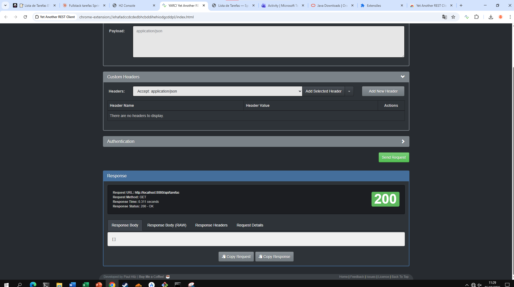
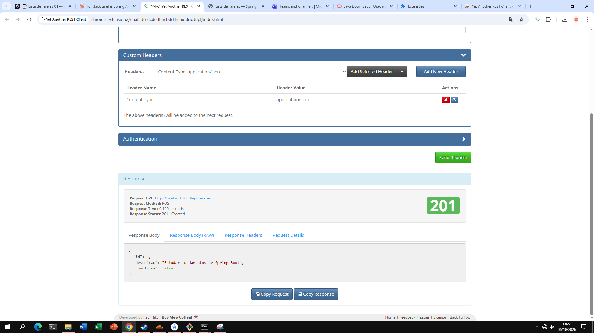
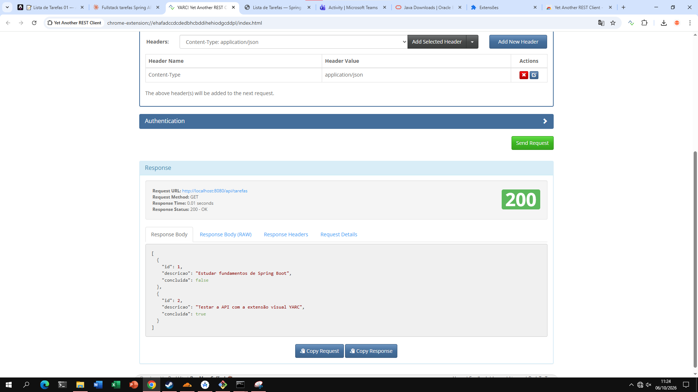
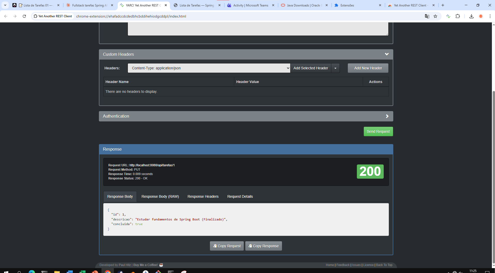
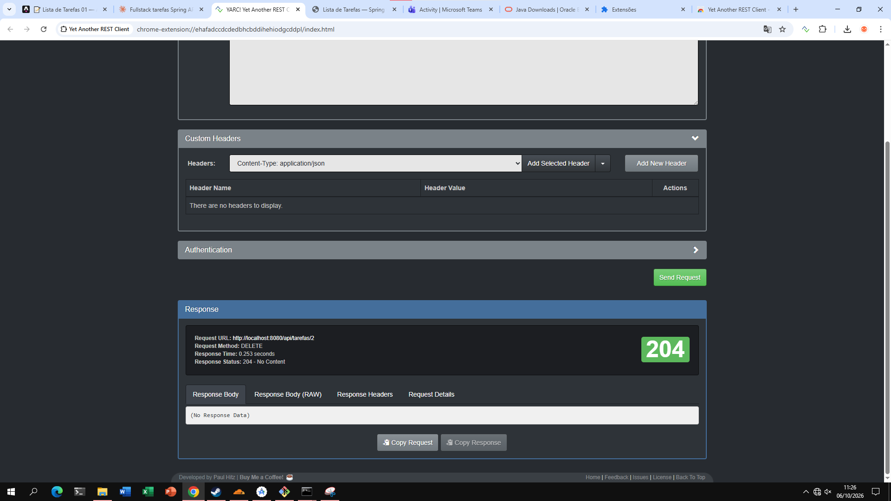
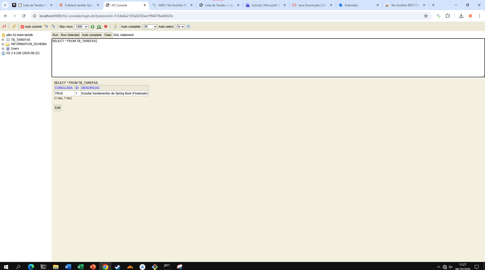

# 📝 Lista de Tarefas 01 — API REST com Spring Boot & Interface Thymeleaf

Projeto desenvolvido conforme o roteiro **Lista de Tarefas 01** do Portal ADS.

- **Spring Boot:** 4.1.1 (Maven) · **Java:** 17 (roda em JDK 17 ou superior)
- **Group:** `br.com.curso` · **Artifact:** `api-spring` · **Pacote raiz:** `br.com.curso.listadetarefas.api`
- **Dependências:** Spring Web, Spring Data JPA, Thymeleaf, H2 Database, Lombok

## Estrutura

```
api-spring/
├── pom.xml
├── mvnw / mvnw.cmd
└── src/
    ├── main/java/br/com/curso/listadetarefas/api/
    │   ├── ListadetarefasApiApplication.java
    │   └── tarefa/
    │       ├── Tarefa.java                 (Entidade JPA → tb_tarefas)
    │       ├── TarefaRepository.java       (Spring Data JPA)
    │       ├── TarefaService.java          (Regras de negócio)
    │       ├── TarefaRestController.java   (API REST /api/tarefas)
    │       └── TarefaWebController.java    (Interface web /tarefas)
    ├── main/resources/
    │   ├── application.properties
    │   └── templates/tarefas.html
    └── test/java/br/com/curso/listadetarefas/api/
        └── ListadetarefasApiApplicationTests.java
```

## Como executar

Na pasta onde está o `pom.xml`:

```bash
# Windows
.\mvnw.cmd spring-boot:run

# Linux / macOS
./mvnw spring-boot:run
```

Quando aparecer `Started ListadetarefasApiApplication`, acesse:

| Recurso | URL |
|---|---|
| Interface web (Thymeleaf) | http://localhost:8080/tarefas |
| API REST (JSON) | http://localhost:8080/api/tarefas |
| Console H2 | http://localhost:8080/h2-console (JDBC URL `jdbc:h2:mem:testdb`, usuário `sa`, senha em branco) |

## Endpoints da API

| Método | Rota | Sucesso | Erro |
|---|---|---|---|
| GET | `/api/tarefas` | 200 OK | — |
| GET | `/api/tarefas/{id}` | 200 OK | 404 Not Found |
| POST | `/api/tarefas` | 201 Created | 415 sem `Content-Type: application/json` |
| PUT | `/api/tarefas/{id}` | 200 OK | 404 Not Found |
| DELETE | `/api/tarefas/{id}` | 204 No Content | 404 Not Found |

## Matriz de homologação (resultados obtidos)

| Checkpoint | Operação | Resultado |
|---|---|---|
| CP-01 | GET `/api/tarefas` (carga inicial) | 200 OK, `[]` ✅ |
| CP-02 | POST `/api/tarefas` | 201 Created, `"id": 1` ✅ |
| CP-03 | GET `/api/tarefas` (com dados) | 200 OK, lista com 2 tarefas ✅ |
| CP-04 | PUT `/api/tarefas/1` | 200 OK, `"concluida": true` ✅ |
| CP-05 | DELETE `/api/tarefas/2` | 204 No Content ✅ |
| CP-06 | `SELECT * FROM TB_TAREFAS;` no H2 Console | Dados íntegros ✅ |
| Extra | GET/PUT/DELETE em ID inexistente | 404 Not Found ✅ |
| Extra | Interface `/tarefas`: adicionar, concluir/reabrir, excluir | Funcionando e refletido na API ✅ |

## Evidências dos testes (YARC + H2 Console)

Prints na pasta [`docs/prints`](docs/prints), na ordem de execução do roteiro.

### 1. CP-01 — GET `/api/tarefas` (lista vazia) → 200 OK `[]`


### 2. CP-02 — POST `/api/tarefas` (tarefa 1) → 201 Created


### 3. POST `/api/tarefas` (tarefa 2) → 201 Created


### 4. CP-03 — GET `/api/tarefas` (lista com dados) → 200 OK


### 5. CP-04 — PUT `/api/tarefas/1` → 200 OK


### 6. CP-05 — DELETE `/api/tarefas/2` → 204 No Content


### 7. CP-06 — `SELECT * FROM TB_TAREFAS;` no H2 Console


## Observações sobre a versão 4.x do Spring Boot

O `pom.xml` foi gerado diretamente pelo Spring Initializr. Na linha 4.x, alguns starters mudaram de nome
em relação ao exemplo do roteiro (que é ilustrativo):

- `spring-boot-starter-web` → `spring-boot-starter-webmvc`
- O console do H2 agora precisa do módulo `spring-boot-h2console` (já incluído).

Se o seu JDK for 21, pode alterar `<java.version>17</java.version>` para `21` no `pom.xml` (opcional).
